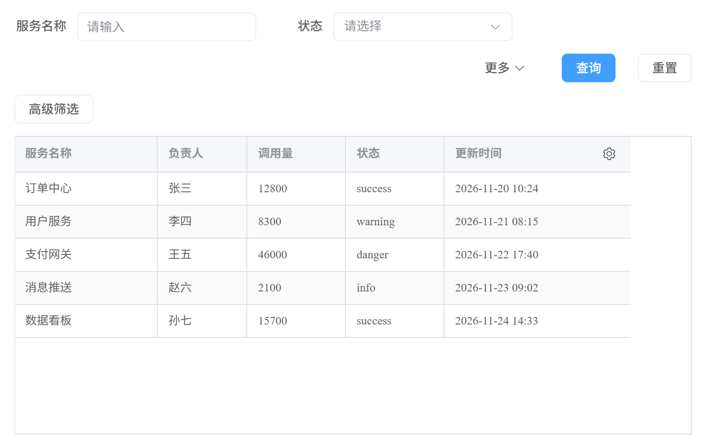
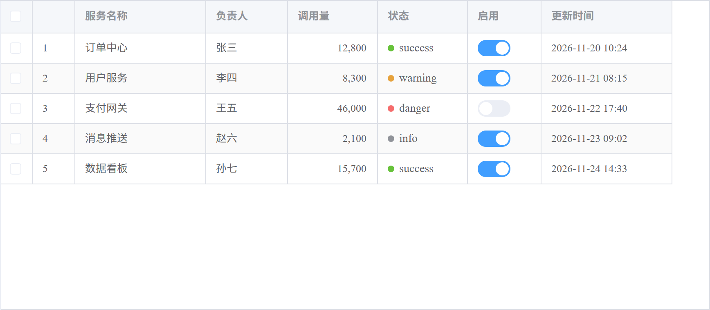
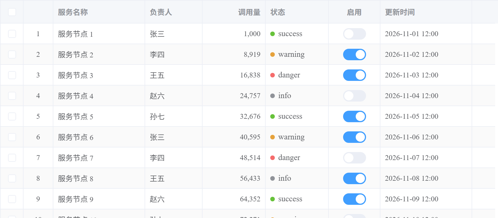
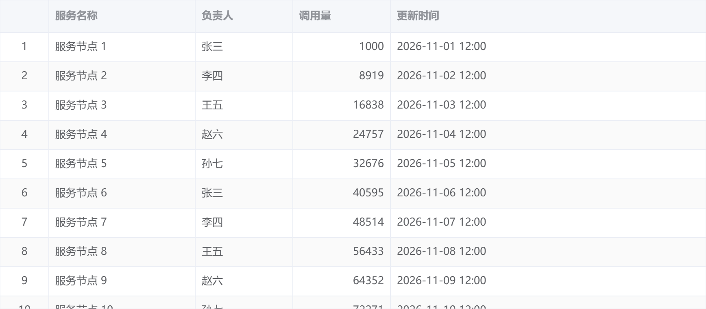
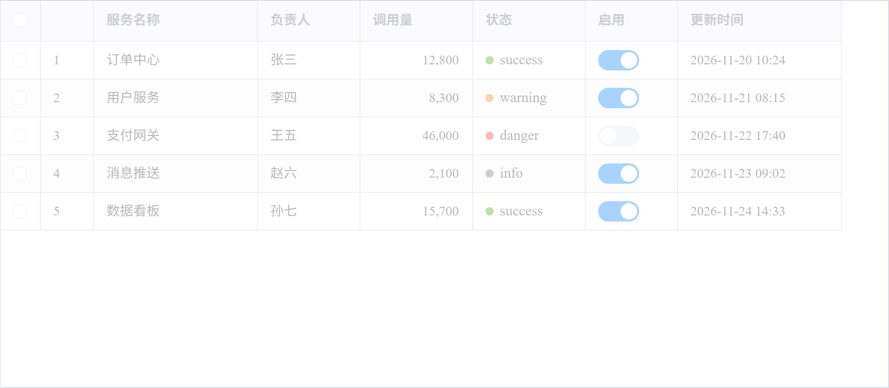
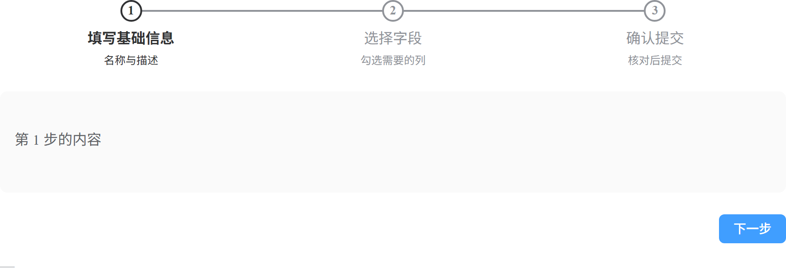
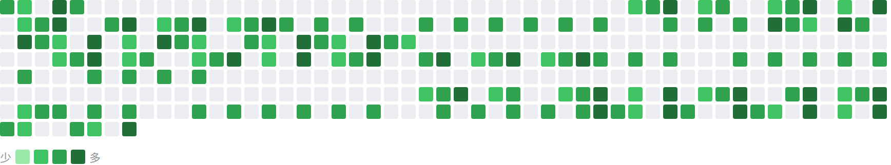
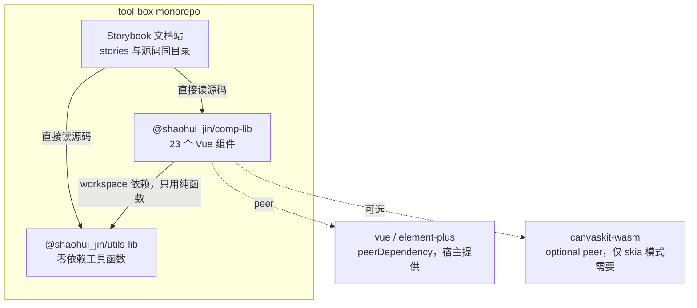
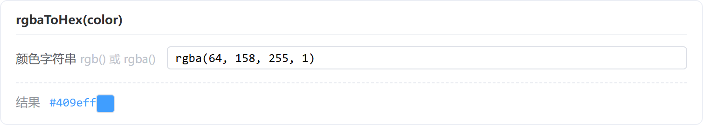

# tool-box

[](https://pnpm.io)
[](https://nodejs.org)
[](LICENSE)
[](https://shaohui-jin.github.io/tool-box/)

Vue 3 组件库与零依赖工具库。一个 monorepo，两个可独立发布的包。

**[在线文档](https://shaohui-jin.github.io/tool-box/)** · 23 个组件 · 20 个工具函数 · 5 种表格渲染引擎



---

## 这个项目是什么

| 包                                             | 内容                                               | 依赖              |
| ---------------------------------------------- | -------------------------------------------------- | ----------------- |
| [`@shaohui_jin/comp-lib`](packages/comp-lib)   | Vue 3 组件库，含 CRUD 表格、交互组件与主题配置系统 | vue、element-plus |
| [`@shaohui_jin/utils-lib`](packages/utils-lib) | 工具函数与类型体操，**零运行时依赖**               | 无                |

两者是单向依赖：comp-lib 用 utils-lib 的纯函数，反向不成立。
所以 utils-lib 可以被 Node 脚本、SSR、非 Vue 前端直接 import。

---

## 亮点

**一张表格配置，五种渲染引擎**

同一个 `columns` 数组，切换 `mode` 就能从 Element Plus 的 `el-table` 换到 Canvas 手绘。
数据量从几十行到几十万行，不用改业务代码。

<table>
<tr>
<td width="50%"></td>
<td width="50%"></td>
</tr>
<tr>
<td></td>
<td></td>
</tr>
</table>

> `canvas` 与 `canvas-tile` 视觉一致（都是 Canvas 绘制，差别在重绘策略），所以只放一张。

**一套配置同时驱动自己与 Element Plus**

`createCompLib({ theme })` 注入的 CSS 变量同时覆盖 `--comp-*`（组件库自有）
与 `--el-*`（Element Plus），所以库内组件和原生 `el-*` 组件不会出现两种配色。


**零依赖的工具库**

`dist/index.js` 只有 6 KB，`dependencies` 是空的。
不引 vue、不引 lodash，产物里也没有它们的引用。

**文档即测试**

stories 与源码同目录，Props / Events 表从 TypeScript 类型自动推导，不手写 API 文档。
改组件时顺手改 story，两者不会漂移。

---

## 组件速览

### 基础

`Tag` `Dot` `Image3D` `ImageCarousel` `ImagePointer` `ImageLightbox` `CodeBlock` `WidgetTabs`


### 交互

`SplitPane` `DragSortList` `FloatingToolbar` `TreeTransfer` `StepWizard` `ContextMenu` `CanvasTime` `CanvasCountUp` `HeatmapCalendar`



<table>
<tr>
<td width="50%"></td>
<td width="50%"></td>
</tr>
</table>

### CRUD

`BaseTable` `BaseSearch` `BaseSearchField` `BaseSearchDrawer` `BaseColumnSetting` `BaseCrud`


---

## 架构



依赖方向是单向的：utils-lib 不知道 comp-lib 的存在。
这条边界很关键 —— 它保证工具库能被任何环境使用。

---

## 工具库

九个模块，每个函数都有可交互的文档页（改参数实时看返回值）。



| 模块     | 导出                                                             | 说明                         |
| -------- | ---------------------------------------------------------------- | ---------------------------- |
| 颜色     | `rgbaToHex` `hexToRGBA` `colorToRGBA`                            | rgb/rgba 字符串与 hex 互转   |
| 数字     | `getRandom` `scaleFormat`                                        | 闭区间随机整数、修浮点显示   |
| 对象     | `flattenObj` `unFlatten` `isObjEqual` `isObjEmpty`               | 扁平化/还原、深度比较、判空  |
| 数组     | `flattenTree` `isArrEqual`                                       | 树扁平化、无序比较           |
| 剪贴板   | `copyToClipboard`                                                | 带 execCommand 回退的复制    |
| 防抖     | `debounce`                                                       | 纯函数防抖，无 Vue 依赖      |
| 性能     | `performChunk` `concurRequest`                                   | 分片执行、并发控制           |
| 权限     | `usePermission`                                                  | 位运算权限，上限 31 位       |
| 类型体操 | `getValue` `setValue` `getOptional` `setOptional` `arrayToUnion` | 只在编译期存在，零运行时开销 |

---

## 快速开始

```bash
corepack enable        # 使用 package.json 里固定的 pnpm 10
pnpm install
pnpm storybook         # 文档站，http://localhost:6006
```

在业务项目里使用：

```ts
import { createApp } from "vue";
import ElementPlus from "element-plus";
import "element-plus/dist/index.css";
import "@shaohui_jin/comp-lib/style.css";
import CompLib, { createCompLib, elementPlusLocale } from "@shaohui_jin/comp-lib";

const app = createApp(App);
app.use(ElementPlus, { locale: elementPlusLocale });
app.use(createCompLib({ theme: { colorPrimary: "#6366f1" } }));
app.use(CompLib);
app.mount("#app");
```

`vue`、`element-plus`、`@element-plus/icons-vue` 都是 peerDependency，需要宿主自己安装。

---

## 常用命令

| 命令                     | 作用                      |
| ------------------------ | ------------------------- |
| `pnpm build`             | 构建两个包                |
| `pnpm typecheck`         | vue-tsc + tsc             |
| `pnpm test`              | utils-lib 单测            |
| `pnpm test:hooks`        | 提交钩子单测              |
| `pnpm lint`              | eslint + stylelint        |
| `pnpm storybook`         | 文档站开发模式，6006 端口 |
| `pnpm build-storybook`   | 构建静态文档站            |
| `pnpm preview-storybook` | 预览构建产物，6007 端口   |
| `pnpm shoot:readme`      | 重新生成本文档里的截图    |

开发模式与预览产物的区别：`storybook dev` 边编译边服务，永远是最新源码；
`build-storybook` 产出真实发布物，`preview-storybook` 用它验证部署后的样子。
提交前跑一次预览，能提前发现只在生产构建里暴露的问题。

用 `http-server` 而不是 `serve`：后者会把 `/iframe.html` 重写成 `/iframe`，
Storybook 取不到 iframe 就显示 "No Preview"。这不是配置问题，是 `serve` 的 rewrite 行为。

---

## 发布

两个包独立发版，版本号各自维护在 `packages/*/package.json`。

```bash
pnpm --filter @shaohui_jin/utils-lib publish
pnpm --filter @shaohui_jin/comp-lib publish
```

顺序不能反：comp-lib 的 `workspace:^` 依赖需要 utils-lib 先发。
`prepublishOnly` 会自动跑 `typecheck && build`，不会把没编译的产物传上去。

[release.yml](.github/workflows/release.yml) 已写好自动发布流程（按 tag 闸门判断是否需要发布），
但 **push 触发分支默认注释掉** —— npm 包一经发布不可撤回，版本号必须人工确认。

文档站则是自动的：[deploy-storybook.yml](.github/workflows/deploy-storybook.yml)
在 push 到 `master` 后自动部署。两者取舍不同，所以策略不同。

---

## 目录

```text
packages/
├── comp-lib/
│   └── src/
│       ├── components/   # basic / interaction / crud
│       ├── config/       # createCompLib、ConfigProvider、主题预设
│       ├── style/        # $lib-* SCSS 令牌
│       ├── type/         # 组件 props / emits 类型
│       └── stories/      # story 共用 fixture 与 MDX
└── utils-lib/
    └── src/              # 纯函数与类型；stories/ 放交互面板
docs/images/              # README 截图，由 scripts/shoot-readme.mjs 生成
scripts/hooks/            # 提交钩子
.storybook/               # Storybook 配置
```

---

## 贡献

见 [CONTRIBUTING.md](CONTRIBUTING.md)。核心一条：**不留 AI 作者署名**，
由 husky 的 `commit-msg` 钩子自动剥离。

## License

MIT
